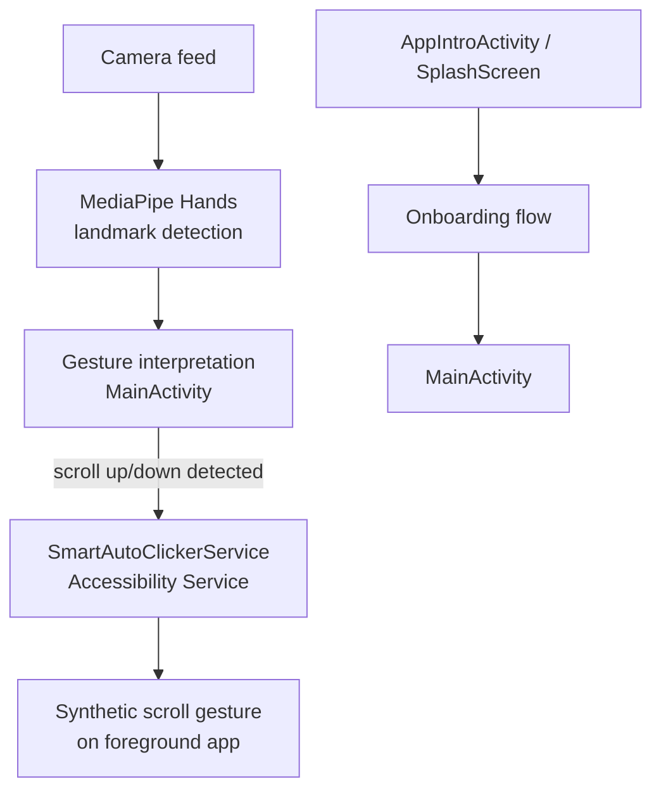

# Scrolly (HandGestureScroller)

Android app that auto-scrolls the screen using hand gestures detected through the camera — no touching the phone required. Built on Google's MediaPipe Hands solution.

## How it works

The camera feed is processed frame-by-frame by MediaPipe's hand-landmark model, which detects hand position and finger landmarks in real time. The app interprets specific hand movements/gestures (e.g. raised hand moving up/down) as scroll commands, then uses Android's Accessibility Service (`SmartAutoClickerService`) to perform the actual scroll gesture on whatever app is in the foreground — letting users scroll feeds hands-free.

## Architecture

| Component | Location | Role |
|---|---|---|
| `MainActivity` | `app/src/main/java/.../MainActivity.java` | Camera capture + MediaPipe pipeline entry point |
| `HandsResultGlRenderer` / `HandsResultImageView` | `utils/` | Renders MediaPipe hand-landmark results for preview/debugging |
| `SmartAutoClickerService` | `service/SmartAutoClickerService.kt` | Accessibility Service that performs the actual scroll on screen |
| `AppIntroActivity`, `SplashScreen` | `onboarding/` | First-run onboarding and permission setup |
| `neumorphism` module | `neumorphism/` | Standalone neumorphic UI component library used for styling |

## Tech stack

Android (Java/Kotlin) · MediaPipe Hands · Android Accessibility Service · Gradle

## Setup

Open in Android Studio, let Gradle sync, and run on a device with a camera. The Accessibility Service permission must be granted manually in Android Settings for auto-scroll to function.
